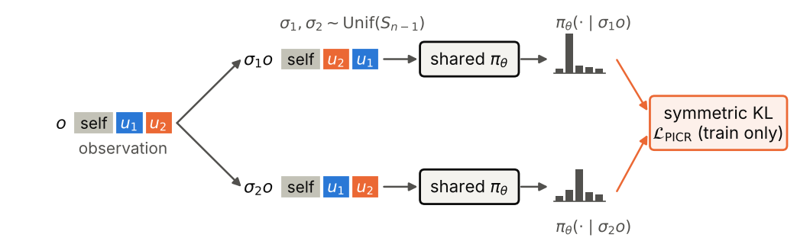

# Does teammate-order invariance help zero-shot coordination?

[](https://github.com/raj200501/PICR-MA/actions/workflows/ci.yml)

In cooperative multi-agent RL, each agent usually sees its teammates as feature
blocks concatenated in a fixed but arbitrary order. A plain MLP policy can
learn to depend on that order, for example treating "the first teammate"
differently from "the second", even though teammates are interchangeable. This
repository tests whether removing that dependence helps agents coordinate with
partners they were not trained with (**zero-shot coordination**, or ZSC).

The intervention studied is **PICR** (permutation-invariant consistency
regularization). During training it penalizes the symmetric KL divergence
between the policy's action distributions under two random reorderings of the
teammate blocks. PICR adds no parameters and no test-time cost: the deployed
network is the same MLP as IPPO's, and only the training loss changes. PICR is
compared with four baselines that share the same learner and hyperparameters:

| Method | How it handles teammate order |
|---|---|
| IPPO | Does not handle it; an MLP over the concatenated observation |
| **PICR** | Trains the MLP toward invariance with a consistency penalty |
| Deep Sets | Invariant by construction (shared teammate encoder + mean pooling) |
| Order augmentation | Feeds the MLP a fresh random teammate order at every training step |
| Order randomization | Each agent keeps one random teammate order per training episode (in the spirit of Other-Play) |

> **Status:** experiments are being re-run with the corrected implementation;
> the results section below will be filled in when they finish. Earlier
> versions of this repository had implementation errors that invalidate every
> result they produced; see [docs/corrections.md](docs/corrections.md).

## Method

<p align="center"></p>

For an observation `o` with teammate blocks `u_1, …, u_{n-1}`, sample two
permutations `σ1, σ2` uniformly and add

```
L_PICR = λ · E[ ½ KL(π(·|σ1 o) ‖ π(·|σ2 o)) + ½ KL(π(·|σ2 o) ‖ π(·|σ1 o)) ]
```

to the PPO loss (`picr_ma/regularizers.py`). This is a symmetric two-view
variant of consistency regularization under data augmentation (cf. DrAC,
Raileanu et al., 2021, which regularizes one augmented view toward the fixed
unaugmented one).

## Experimental protocol

The full protocol is in the paper (`paper/sections/setup.tex`).

- **Environments:** PettingZoo MPE `simple_spread_v3` (3 agents cover 3
  landmarks) and `simple_adversary_v3` (3 cooperating agents vs. a co-trained
  adversary), re-implemented as batched NumPy environments
  (`picr_ma/envs/mpe.py`). They match the reference
  [`mpe2`](https://mpe2.farama.org/) implementation step for step under the
  same seeds and actions (`tests/test_envs.py`) and run about 50× faster
  (`scripts/benchmark_env.py`).
- **Learner:** shared-parameter PPO (IPPO) with per-agent GAE, tuned on IPPO
  alone and then reused for every method ([docs/tuning.md](docs/tuning.md));
  5M environment steps per run.
- **Seeds:** disjoint ranges for tuning (1000), choosing λ (100–104), the main
  comparison (0–9, ten runs per method) and a check at twice the training
  budget (20–24). Final numbers are scored on 240 reserved *test* episodes; λ
  is chosen on separate *validation* episodes; training never sees either.
- **Choosing λ:** a rule fixed before any selection run (highest cross-play on
  the selection seeds) picked λ = 0.01 for `simple_spread_v3` and 0.3 for
  `simple_adversary_v3`. The whole sweep, with IPPO as λ = 0, doubles as a
  dose-response test: larger λ makes policies more invariant, so if invariance
  helped, cross-play would rise with λ.
- **Zero-shot coordination:** all-pairs cross-play. For runs A ≠ B, A's policy
  controls one agent and B's the other two, with A seated in each slot in turn.
  The primary endpoint is each method's self-play − cross-play gap compared
  with IPPO's. In `simple_adversary_v3`, every team faces the same pool of
  adversaries.
- **Does order sensitivity cost anything?** Every run sees teammates in the
  same index order, so cross-play cannot expose an order convention that all
  runs share. The *order-shift* test changes the order: each team plays itself
  with per-agent teammate orderings that no relabeling of the agents can
  produce, while the orderings that *are* relabelings serve as a null control.
  Replacing teammate features with another episode's shows how much the
  policies use teammates at all. The *slot contrast* compares cross-play with
  the ego listed first versus second by its partners.
- **Where cross-play losses come from:** an additive model (cross-play = ego
  competence + partner competence + pair residual) tests whether any pairs
  fall short of what their members' individual skill predicts, reproducibly.
- **Instrument checks:** scripted controllers with known conventions and known
  order dependence go through the same evaluation code, to show it detects
  these effects when they exist (`scripts/positive_control.py`).
- **Statistics:** training runs are the unit of analysis. Cluster bootstrap
  intervals; permutation tests over run labels; Holm adjustment across the
  four comparisons with IPPO; minimum detectable effects for null results.
- **Interim analyses:** some of this protocol was settled after interim looks
  at `simple_spread_v3` results. The paper lists every such change in order,
  and treats the `simple_spread_v3` comparisons as partly exploratory.

## Results

*Pending: the corrected experiments are running.*

## Reproducing

Requires Python ≥ 3.12, and TeX Live (`latexmk`, `pdflatex`, `natbib`) for the
paper.

```bash
python3.12 -m venv .venv && . .venv/bin/activate
make install        # the locked environment (requirements.lock, CPU PyTorch)
make test           # 68 tests, about 2 minutes
make paper          # tables, figures, numbers and PDF from the committed results/
make reproduce      # retrain and re-evaluate everything, then build the paper
```

To check any single number in the cross-play tables against the committed
policies, score two runs together (about a minute on one core):

```bash
python scripts/pair.py results/main/simple_spread_v3/ippo/seed0 results/main/simple_spread_v3/picr/seed3
```

`make reproduce` trains 175 runs (60 for choosing λ, 100 for the main
comparison, 15 for the budget check). Each run is one single-threaded process
of roughly 7–30 minutes, so the whole study takes about half a day on a 4-core
machine. Stages run in order, and finished work is skipped on re-runs:

| Step | Command |
|---|---|
| Choose λ on seeds 100–104 | `make select` |
| Main comparison on seeds 0–9, cross-play and order shift | `make main crossplay-main order-shift` |
| Twice the training budget, seeds 20–24 | `make long` |
| Reference controllers, instrument checks, benchmarks | `make reference positive-control env-speed overhead` |
| Tables, figures, numbers, `results/analysis.json` | `make analyze` |
| Paper PDF | `make paper` |
| IPPO tuning sweep (not part of `reproduce`) | `make tuning` |

Every run is defined in [`configs/experiments.yaml`](configs/experiments.yaml).
`results/` holds each run's config, training log, final policy and evaluation
summary, and every evaluation output with the git commit and software versions
that produced it. `tests/test_committed_results.py` checks that the committed
runs are exactly the ones the config defines, and that the current code
reproduces their training logs.

## Repository layout

```
picr_ma/
  envs/mpe.py          batched MPE scenarios (verified against mpe2)
  envs/slicing.py      teammate blocks, permutations, relabeling vs. genuine order patterns
  networks.py          actor-critic with MLP or Deep Sets encoder
  ppo.py               clipped PPO with per-agent GAE
  regularizers.py      the PICR penalty
  train.py             one training run -> config, metrics, policy, summary
  evaluation.py        episode playback, self-play, permutation sensitivity
  crossplay.py         seat-rotated cross-play and order shift, shared adversary pool
  scripted.py          scripted controllers for reference returns and instrument checks
  provenance.py        git commit and software versions recorded with each output
  analysis/            bootstrap and permutation statistics, additive model, tables, figures
scripts/               suite runner, evaluation, λ selection, controls, benchmarks, analysis
configs/experiments.yaml
results/               per-run artifacts, evaluation outputs, aggregated analysis
paper/                 LaTeX source; figures, tables and numbers are generated
docs/                  tuning record, corrections, README figures
```

## How this was built

I built this with AI coding assistants working under my direction: OpenAI Codex
for the April 2026 version, and Claude Code for the October–November 2026
rewrite and for the code reviews that found the defects listed in
[docs/corrections.md](docs/corrections.md). The research question, the
experimental design and the decisions about what to run and report are mine.

## Citation

```bibtex
@misc{kashikar2026picr,
  author = {Kashikar, Raj},
  title  = {Does Teammate-Order Invariance Help Zero-Shot Coordination? A Controlled Study in Cooperative MARL},
  year   = {2026},
  url    = {https://github.com/raj200501/PICR-MA}
}
```

## License

MIT
