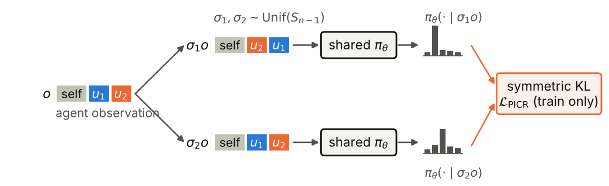

# Does teammate-order invariance help zero-shot coordination?

[](https://github.com/raj200501/PICR-MA/actions/workflows/ci.yml)

In cooperative multi-agent RL, each agent usually sees its teammates as feature
blocks concatenated in a fixed but arbitrary order. A plain MLP policy can
learn to depend on that order, for example treating "the first teammate"
differently from "the second", even though teammates are interchangeable. This
repository tests whether removing that dependence helps agents coordinate with
partners they were not trained with (**zero-shot coordination**, or ZSC).

The intervention studied is **PICR** (permutation-invariant consistency
regularization). During training it penalizes the symmetric KL divergence
between the policy's action distributions under two random reorderings of the
teammate blocks. The deployed policy is unchanged. PICR is compared with three
baselines that share the same learner and hyperparameters:

| Method | How it handles teammate order |
|---|---|
| IPPO | Does not handle it; an MLP over the concatenated observation |
| **PICR** | Trains the MLP toward invariance with a consistency penalty |
| Deep Sets | Invariant by construction (shared encoder + mean pooling) |
| Order augmentation | Shows the MLP randomly permuted teammate blocks |

> **Status:** experiments are being re-run with the corrected implementation;
> the results section below will be filled in when they finish. Earlier
> versions of this repository had implementation errors that invalidate every
> result they produced; see [docs/corrections.md](docs/corrections.md).

## Method

<p align="center"></p>

For an observation `o` with teammate blocks `u_1, …, u_{n-1}`, sample two
permutations `σ1, σ2` uniformly and add

```
L_PICR = λ · E[ ½ KL(π(·|σ1 o) ‖ π(·|σ2 o)) + ½ KL(π(·|σ2 o) ‖ π(·|σ1 o)) ]
```

to the PPO loss (`picr_ma/regularizers.py`). This is the teammate-permutation
case of consistency regularization under data augmentation (cf. DrAC,
Raileanu et al., 2021).

## Experimental protocol

- **Environments:** PettingZoo MPE `simple_spread_v3` (3 agents cover 3
  landmarks) and `simple_adversary_v3` (3 cooperating agents vs. a co-trained
  adversary), re-implemented as batched NumPy environments
  (`picr_ma/envs/mpe.py`). They match the reference
  [`mpe2`](https://mpe2.farama.org/) implementation step for step under the
  same seeds and actions (`tests/test_envs.py`) and run about 50× faster.
- **Learner:** shared-parameter PPO (IPPO) with per-agent GAE, tuned on IPPO
  alone and then reused for every method ([docs/tuning.md](docs/tuning.md));
  5M environment steps per run.
- **Seeds:** disjoint ranges for tuning (1000+), choosing λ (100–104) and
  final evaluation (0–9). Evaluation episodes use reserved environment seeds
  that training never sees.
- **Zero-shot coordination:** all-pairs cross-play. For runs A ≠ B, A controls
  one agent and B the other two, on 200 shared evaluation episodes. Self-play
  (A = A) is scored on the same episodes. In `simple_adversary_v3`, every team
  faces the same pool of adversaries.
- **Invariance:** Jensen–Shannon divergence between action distributions
  under every non-identity teammate permutation, on states the trained policy
  visits.
- **Statistics:** seeds are the unit of analysis. Cross-play uses a cluster
  bootstrap over seeds. Method differences are tested with permutation tests
  over run labels.

## Results

*Pending: the corrected experiments are running.*

## Reproducing

```bash
make install        # pinned dependencies (CPU PyTorch), Python >= 3.12
make test           # 40 tests, under a minute
make reproduce      # all training runs, cross-play, analysis and the paper PDF
```

`make reproduce` trains about 130 runs of 5M steps (roughly 25 CPU-minutes
each). It runs these stages in order, and finished runs are skipped on re-runs:

| Step | Command |
|---|---|
| Choose λ on seeds 100–104 | `make select` |
| Main comparison, seeds 0–9 | `make main crossplay-main` |
| Tables, figures, `results/analysis.json` | `make analyze` |
| Paper PDF | `make paper` |

Every run is defined in [`configs/experiments.yaml`](configs/experiments.yaml),
and its artifacts (config, training curve, final policy, evaluation summary)
are committed under `results/`, so cross-play and analysis can be re-run
without retraining.

## Repository layout

```
picr_ma/
  envs/mpe.py          batched MPE scenarios (verified against mpe2)
  envs/slicing.py      teammate-block structure and permutations
  networks.py          actor-critic with MLP or Deep Sets encoder
  ppo.py               clipped PPO with per-agent GAE
  regularizers.py      the PICR penalty
  train.py             one training run -> config, metrics, policy, summary
  evaluation.py        self-play, permutation sensitivity
  crossplay.py         all-pairs cross-play with a shared adversary pool
  analysis/            bootstrap and permutation statistics, tables, figures
scripts/               suite runner, cross-play, λ selection, analysis, benchmarks
configs/experiments.yaml
results/               per-run artifacts and aggregated analysis
paper/                 LaTeX source; figures and tables are generated
docs/                  tuning record and corrections
```

## Citation

```bibtex
@misc{kashikar2026picr,
  author = {Kashikar, Raj},
  title  = {Does Teammate-Order Invariance Help Zero-Shot Coordination? A Controlled Study in Cooperative MARL},
  year   = {2026},
  url    = {https://github.com/raj200501/PICR-MA}
}
```

## License

MIT
